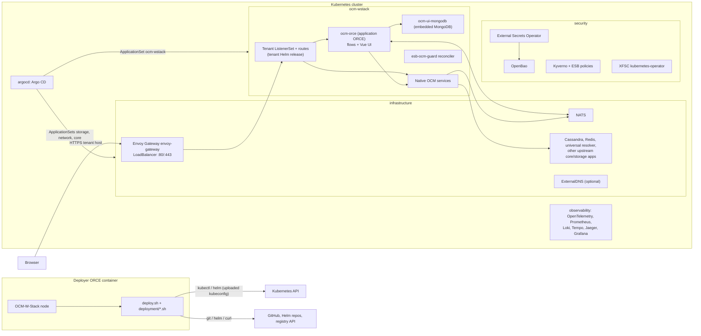

<!-- SPDX-License-Identifier: Apache-2.0 -->

# OCM W-Stack (ESB module 12.6.4)

Operator guide for the FACIS Easy Stack Builder module **OCM-WStack**, delivered under ESB ICAM Change Request CR01. The module contains:

- a Node-RED/ORCE **deployer node** (`OCM-W-Stack`, npm package `orce-esb-ocmwstack`), and
- the charts, flows and UI files that the deployer installs into a Kubernetes cluster: the native XFSC OCM W-Stack services at a pinned upstream revision, plus a dedicated **application ORCE** that hosts the backend flows and the Vue UI.

Example hostnames in this guide: `ocm-ionos.facis.cloud` (IONOS) and `ocm-osc.facis.cloud` (OSC).

## Contents

1. [Scope and exclusions](#scope-and-exclusions)
2. [Architecture](#architecture)
3. [Prerequisites](#prerequisites)
4. [Install on IONOS](#install-on-ionos)
5. [Install on OSC](#install-on-osc)
6. [Configuration reference](#configuration-reference)
7. [Secrets and credentials](#secrets-and-credentials)
8. [Installing the deployer node](#installing-the-deployer-node)
9. [Post-install verification](#post-install-verification)
10. [Operations](#operations)
11. [Troubleshooting](#troubleshooting)
12. [Versions and pins](#versions-and-pins)
13. [Known limitations and open upstream issues](#known-limitations-and-open-upstream-issues)
14. [Security notes](#security-notes)
15. [API reference and further docs](#api-reference-and-further-docs)
16. [Test evidence](#test-evidence)

---

## Scope and exclusions

**What this module covers (as implemented in this repository)**

- Deployer node and CLI (`deploy.sh`) for install, resume, repair, inspection, validation, diagnostics and tenant teardown.
- The native XFSC OCM W-Stack services and their infrastructure, installed from the pinned `eclipse-xfsc/deployment` revision (see [Versions and pins](#versions-and-pins)).
- One tenant per installation, served over HTTPS with an uploaded certificate.
- A dedicated application ORCE (`ocm-orce`) with backend flows (`charts-runtime/files/flows.json`) and a browser UI (`charts-runtime/files/ui/`) for: credential list and detail, verification, revocation, local deletion, provenance, receiving offers, issuance, credential type registry, relationships (DIDComm), Gaia-X Clearing Center acquisition, users, roles, audit log and health.
- Local accounts and roles in MongoDB with a 24-hour absolute session.
- BDD acceptance tests for the deployed API (`test/bdd/`).

**Exclusions**

- **PCM integration is excluded** (CR01 activity breakdown and timeline v5.0 of 26 June 2026, section 2.2). The runtime refuses a configuration with `pcm.enabled` (`config` library in `flows.json`), `/orce/ui-api/v1/auth/config` reports `features.pcm: false`, and `validate` checks this value.
- **Vue instead of React.** The realization offer in CR01, which the principal accepted, names ORCE, uibuilder, Vue 3 and MongoDB as the stack. The UI uses the Vue 3.5.13 runtime build served by uibuilder 7.5.0. There is no compiled front-end build; the files under `charts-runtime/files/ui/` are delivered as they are.
- **No dedicated container image.** CR01 and plan v5.0 (phase 8) name Helm/Docker packaging for the UI bundle. This release delivers the Helm charts and the ORCE node package; the application runs on the stock `ecofacis/xfsc-orce:2.0.15` image and installs its npm dependencies at the first start of each release (see `docs/ADR.md`, ADR-003). A dedicated image needs a container registry agreed with the principal and is proposed as a follow-up.
- Automatic certificate issuance (ACME/cert-manager issuer) is not used: the upstream `INFRA/network/cluster-issuer` and `INFRA/network/bind9` applications are excluded and only an uploaded certificate is supported.
- Removal of the whole stack is not automated; `teardown` removes only the tenant Helm release (see [Operations](#operations)).

For the contractual scope, see CR01 itself. This README describes only what the code does.

## Architecture

There are two ORCE instances:

1. **Deployer ORCE**: an existing ORCE/Node-RED instance where you install the `OCM-W-Stack` node. An Inject node triggers an action. The node runs `bash deploy.sh <action>` in the same container. That container needs the tools from [Tools and versions](#tools-and-versions) and network access to the cluster API and to the internet hosts listed in [Network egress allow-list](#network-egress-allow-list).
2. **Application ORCE**: the `ocm-orce` Deployment in namespace `ocm-wstack`. It is installed by the chart `charts-runtime` (release `ocm-orce-ui`), runs the backend flows and the uibuilder UI, and talks to MongoDB, NATS and the native OCM services.



**Namespaces and components**

| Namespace | Components (as referenced by the deployer) |
| --- | --- |
| `observability` | OpenTelemetry collector, kube-prometheus-stack, Loki, Tempo, Jaeger, Promtail, Grafana (Helm release `observability`) |
| `security` | OpenBao, External Secrets Operator, Kyverno, XFSC kubernetes-operator, namespace releases, ESB policy chart `esb-ocm-gateway` |
| `argocd` | Argo CD from the pinned upstream manifest; the Argo CD Redis image is pulled from `docker.io/library/redis` |
| `infrastructure` | ApplicationSets `storage`, `network`, `core`: Envoy Gateway (`envoy-gateway`, EnvoyProxy `envoy`), NATS, Cassandra, Redis, universal resolver, optional ExternalDNS, optional dashboard routes (`esb-dashboard-routes`) |
| `ocm-wstack` | ApplicationSet `ocm-wstack` (native services), tenant release (default `demotenant`), application ORCE `ocm-orce`, MongoDB `ocm-ui-mongodb`, reconciler `esb-ocm-guard` |

**Native OCM services** (charts pinned in `upstream-lock.json`): Credential Issuance, Credential Retrieval, Credential Verification Service, Crypto Service (assumed to back the Signer; not stated in this repository), Didcomm connector, Dummy Content Signer, Offering Dummy, Policy (TSA policy image `tsa/policy:1.1.2`), Pre-Authorization Bridge, SD-JWT Service, Status List Service, Storage Service, Well-Known Service. The native services remain the system of record for credentials and connections.

**Data stores**

| Store | Content |
| --- | --- |
| MongoDB database `ocm_ui` (embedded `mongo:6.0.20` with PVC `ocm-ui-mongo-data`, or external) | UI accounts, roles, sessions, login limits, preferences, audit log, verification events, credential types, operation and clearing jobs, coordination locks, migrations. Session expiry is enforced at authentication; TTL indexes do the housekeeping. Operation and clearing jobs expire after 72 hours, audit and verification records after 90 days. |
| PVC `ocm-orce-data` | ORCE user directory: installed flows, release directories under `/data/releases`, `node_modules`, uibuilder files |
| Cassandra, Redis, Postgres, Storage service | Native service data (Retrieval, Verification, DIDComm, Pre-Authorization Bridge, Well-Known, stored credentials) |
| OpenBao | Native service secrets (read through the `infrastructure-openbao` ClusterSecretStore) and the tenant transit mount `ocm-wstack/<tenantId>` |
| Kubernetes Secrets | See [Secrets and credentials](#secrets-and-credentials) |

Clearing recovery keeps a received credential encrypted with the application AES-256-GCM key until native storage is confirmed. This is not a second credential inventory.

**NATS.** The ORCE connects to `nats://nats.infrastructure.svc.cluster.local:4222` and listens to `retrieval.offering.publication`. It forwards changes to signed-in browsers over socket.io (`/orce/socket.io`). Issuance requires NATS (`NATS_REQUIRED_FOR_ISSUANCE`). If NATS is down, `/health/ready` reports `degraded: true` and the UI falls back to polling. The reconciler `esb-ocm-guard` checks that `pre-authorization-bridge` and `well-known-service` hold their NATS subscriptions.

**Gateway and routing.** A single Envoy LoadBalancer Service serves ports 80 and 443. The tenant release creates the ListenerSet `<tenantRelease>-xfsc-tenant-gateway` with the TLS Secret `esb-<tenantRelease>-tls`. `charts-runtime` adds two HTTPRoutes: `/orce` → `ocm-orce`, with `/` redirected to `/orce/`, and HTTP → HTTPS (301). Pods in `ocm-wstack`, plus the resolver/DID driver pods in `infrastructure`, receive a `hostAliases` entry that maps the tenant host to the Envoy ClusterIP. This entry comes from the Kyverno policy `esb-ocm-tenant-routing` and from deployer patches, so in-cluster calls to the public tenant URL go through Envoy. Further ESB Kyverno policies (`charts-gateway/templates/`) pin the EnvoyProxy `externalTrafficPolicy`, adjust the Cassandra probe timeouts and the DIDComm startup probe, and give Credential Retrieval the `Recreate` rollout strategy.

**Dashboards.** If **Public dashboards** is on, `esb-dashboard-routes` publishes `https://argocd.<domain>` and `https://grafana.<domain>` with the same uploaded certificate. Otherwise they are not routed.

## Prerequisites

### Tools and versions

All tools must be on the `PATH` of the **deployer ORCE container**, the process that runs `deploy.sh`. `kubectl` and `helm` must resolve to absolute paths. If your kubeconfig uses an exec credential plugin, the plugin binary must also be installed there. Linux is required: the node uses `/proc` and process groups.

`check_tools` (`deployment/common.sh`) checks only that each command exists and reports the Bash version. Every action runs it and fails with `TOOLS` if a tool is missing. From a shell in the deployer container, run `bash deploy.sh check`. The node itself has no `check` action.

| Tool | Used for | Version requirement |
| --- | --- | --- |
| `bash` | All deployment scripts | Bash 4.4 or newer (inferred: the scripts use `shopt -s inherit_errexit`) |
| `node`, `npm` | Password hashing (`ocmwstack.js --hash-password`), Helm recovery helper, package installation | Node.js ≥ 18.17.0 (`package.json` engines) |
| `jq` | All JSON processing | jq 1.6 or newer (inferred: uses `utf8bytelength`, `IN`, `--args`, `--rawfile`) |
| `curl` | Registry check, Argo CD manifest download, HTTPS validation | not checked |
| `git` | Shallow fetch of the pinned upstream commit | not checked |
| `helm` | Chart rendering and installation | **Helm 3.13 or newer, or Helm 4** (enforced, `HELM_VERSION`) |
| `kubectl` | All cluster operations | not checked; use a version within the Kubernetes skew policy of the cluster |
| `openssl` | Certificate validation, random keys | not checked |
| `base64`, `sha256sum`, `timeout`, `setsid`, `nc`, `busybox` | Utilities | presence only |

The container CA store must trust the public CA of your certificate, because `openssl verify` checks the uploaded chain against it.

### Cluster requirements

| Requirement | Detail (from the code) |
| --- | --- |
| Kubernetes version | Not enforced by the deployer. The server version is read and passed to `helm template --kube-version`. The cluster must support the APIs used by the pinned upstream charts (Gateway API `gateway.networking.k8s.io/v1` including `ListenerSet`, Argo CD, External Secrets `v1`). Record the tested versions in [Test evidence](#test-evidence). |
| Identity | A **self-contained** kubeconfig with an explicit current context, embedded credentials and no file references. The identity must be cluster-admin: the preflight requests `*/*/*` in a SelfSubjectAccessReview. |
| Fresh cluster | The first deploy requires that none of the namespaces `observability`, `security`, `argocd`, `infrastructure`, `ocm-wstack` exists (`NOT_FRESH`). Later runs are recognised by the marker ConfigMap `kube-system/esb-ocmwstack-v12`. |
| Nodes | At least one schedulable `Ready` node. |
| LoadBalancer | A working LoadBalancer provisioner. The Envoy Service must receive an IP or hostname in `status.loadBalancer.ingress` and expose ports 80 and 443. |
| Storage | A dynamic provisioner for `ReadWriteOnce` volumes, and **exactly one default StorageClass** unless you set `storageClass`. |
| Cluster DNS | A DNS Service in `kube-system` with TCP and UDP port 53 and a pod selector; it is used to build NetworkPolicy egress rules. |
| NetworkPolicy | The charts create NetworkPolicies; use a CNI that enforces them. |
| Node sizing | **Not stated in the code or the editor help.** ESB-owned workloads request/limit: `ocm-orce` (and its init container) 100m/256Mi to 2 CPU/2Gi; MongoDB 100m/256Mi to 1 CPU/1Gi. ESB PVCs: ORCE 3Gi, MongoDB 5Gi, Grafana 5Gi. All other services are sized by the upstream charts. Record the node pools of the tested clusters in [Test evidence](#test-evidence). |

### Network egress allow-list

The hosts below come from the code. Some downloads go to hosts that are named only in upstream files, for example chart archives that a Helm index links to GitHub release assets, or images in the Argo CD manifest. Run `preflight` with egress logging and add those hosts from output 3.

**From the deployer ORCE container**

| Host | When | Purpose (code reference) |
| --- | --- | --- |
| Kubernetes API server (from the kubeconfig) | always | all actions |
| `github.com` | preflight, deploy, repair, install-ui | `git fetch` of `eclipse-xfsc/deployment` at the pinned commit (`checkout_source`, `prepare_charts`) |
| `raw.githubusercontent.com` | preflight, deploy, repair, install-ui | Argo CD `manifests/install.yaml` at the pinned `argoCdCommit` |
| `open-telemetry.github.io`, `prometheus-community.github.io`, `grafana.github.io`, `jaegertracing.github.io` | preflight, deploy, repair, install-ui | Helm dependencies of the observability chart (pinned versions) |
| other Helm repositories declared in the pinned upstream `Chart.yaml` files | same | the deployer runs `helm repo add` for every `https` dependency repository it finds. The upstream bootstrap script uses `openbao.github.io`, `charts.external-secrets.io` and `kyverno.github.io`; confirm in output 3. |
| `kubernetes-sigs.github.io` | only with **Manage DNS records** | ExternalDNS chart 1.23.0 |
| `node-654e3bca7fbeeed18f81d7c7.ps-xaas.io` | preflight, deploy, repair, install-ui | registry API check of `tsa/policy:1.1.2`, plus the HTTPS token endpoint named in the registry's Bearer challenge |
| tenant host, and `argocd.<domain>` / `grafana.<domain>` if dashboards are on | deploy, install-ui, validate | public HTTPS checks (needs DNS and port 443 from the deployer) |
| DNS resolver of the container | always | resolves all hosts above |
| `registry.npmjs.org` (or your npm mirror) | node installation and CLI `npm install` | dependency `bcryptjs` 2.4.3 |

`deployment/network.sh` also defines DNS-over-HTTPS checks against `dns.google` and `cloudflare-dns.com` (`wait_dns`). No action calls them in 12.6.4, so these hosts are not needed.

**From the cluster (nodes and pods)**

| Host | Who | Purpose |
| --- | --- | --- |
| `docker.io` | nodes | `ecofacis/xfsc-orce:2.0.15` (application ORCE and `esb-ocm-guard`), `mongo:6.0.20`, `library/redis` (Argo CD), `hetzner/external-dns-hetzner-webhook` (Hetzner DNS only) |
| `ghcr.io` | nodes | `ionos-cloud/external-dns-ionos-webhook:v0.14.0` (IONOS DNS only) |
| `node-654e3bca7fbeeed18f81d7c7.ps-xaas.io` | nodes | `tsa/policy:1.1.2`, `ocm-wstack/credential-retrieval-service` and other native images |
| registries named in the pinned upstream charts and Argo CD manifest | nodes | collect them from the rendered manifests |
| `github.com` | Argo CD repo-server; Policy service | ApplicationSet sources (`eclipse-xfsc/deployment`); Rego policies (`eclipse-xfsc/rego-policies`) |
| `kubernetes-sigs.github.io` and the Helm repositories of upstream applications | Argo CD repo-server | Helm-based applications |
| `registry.npmjs.org` | `ocm-orce` init container | `npm install` of the runtime dependencies on the first start of each release |
| `compliance-dispatcher.lab.gaia-x.eu` | `ocm-orce` | Gaia-X Clearing Center (fixed endpoint, see [Known limitations](#known-limitations-and-open-upstream-issues)) |
| `did:web` hosts of issuers and holders | universal resolver | DID resolution |
| DNS provider API | ExternalDNS webhook | only with **Manage DNS records** |

The `ocm-orce` NetworkPolicy allows TCP 443 to any non-private IPv4 address. It also allows DNS to `kube-system` and the cluster-internal ports of NATS, the native services, Envoy and MongoDB.

### DNS and TLS

- **TLS is uploaded only** (`tlsMode: "uploaded"`). Upload a PEM full chain (leaf first, then intermediates in order) and its **unencrypted** PEM private key, each at most 128 KiB. The deployer checks that the key matches the leaf, that each intermediate is a CA, that the chain is currently valid for TLS server use and links to a root trusted by the deployer container, and that the leaf covers the tenant host. If dashboards are on, the leaf must also cover `argocd.<domain>` and `grafana.<domain>`.
- A wildcard `*.<domain>` covers exactly one label, so `<tenant>.<domain>` matches but `a.b.<domain>` does not. The tenant subdomain cannot contain dots.
- The certificate is stored in Secret `ocm-wstack/esb-<tenantRelease>-tls`. With dashboards on, copies are stored in `argocd` and `observability`.
- **Renewal**: in the node, replace **both** the full-chain and key uploads, then run `deploy`. The TLS Secret is applied only when its content changes, and `deploy` also refreshes the dashboard copies. `install-ui` refreshes only the tenant Secret.
- **Wildcard expiry note**: one wildcard certificate serves the tenant and both dashboards, so all of them fail together when it expires. There is no automatic renewal and no expiry alert. `inspect` and `validate` re-check the installed chain and report `certificateReady: false` or `status: "action-required"` once it is no longer valid. Put the expiry date in your operations calendar and renew in advance.
- **DNS**: point the tenant host, and the dashboard hosts if enabled, at the Envoy LoadBalancer address. Use an A record for IPv4, AAAA for IPv6, or CNAME if the provider reports a hostname. The node reports these records in output 1 (`payload.access.dns.records`) and in the `public-access` progress events. `inspect` adds `dns.instructions`. Remove stale A/AAAA records.

## Install on IONOS

1. Install the deployer node ([Installing the deployer node](#installing-the-deployer-node)) in an ORCE container that meets [Tools and versions](#tools-and-versions) and the egress list.
2. Create the IONOS Managed Kubernetes cluster and download its kubeconfig. Check that it is self-contained, with an embedded token or certificate.
3. Make sure exactly one StorageClass is the default, or note the name you want in **StorageClass**.
4. Get a public certificate for the tenant host, for example a wildcard `*.facis.cloud` for `ocm-ionos.facis.cloud`.
5. Add the **OCM W-Stack** node (category *Easy Stack Builder*) and fill in:
   - *Cluster*: upload the kubeconfig. Leave **Cluster provider** on *Detect automatically* or choose *IONOS Cloud*. IONOS is detected from the node `providerID` (`ionos`, `ionoscloud`, `ionos-cloud`), from node labels `ionoscloud.com/*` or `cloud.ionos.com/*`, or from a StorageClass provisioner containing `ionos`.
   - *Domain & certificate*: **Base domain** `facis.cloud`, **Tenant name** `ocm-ionos` (this becomes the subdomain; the preview shows `https://ocm-ionos.facis.cloud/orce/`), then the full chain and the key.
   - *Access*: UI administrator and editor administrator usernames, and two different initial passwords (12 or more characters, at most 72 UTF-8 bytes, no control characters).
6. **externalTrafficPolicy = Cluster.** IONOS requires `Cluster`: `normalize_config` and `resolve_config` reject `Local` when the provider is or resolves to `ionos` (`deployment/assets.sh`). The editor always saves `Cluster`. The deployer pins it on the EnvoyProxy (Kyverno policy `esb-ocm-envoy-traffic`) and on every Envoy LoadBalancer Service (`gateway_reconcile`).
7. Choose the DNS mode:
   - **Manual DNS** (*Manage DNS records* off):
     1. Run `deploy`.
     2. When output 2 shows a `public-access` event with `gatewayAddresses`, create the records at your DNS provider. Example: `ocm-ionos.facis.cloud  A  <gateway IPv4>`, plus `AAAA` for IPv6. Add the same records for `argocd.facis.cloud` and `grafana.facis.cloud` if dashboards are on.
     3. The final validation waits up to 300 seconds (or the stage timeout, if shorter) for public HTTPS. If DNS is not ready yet, the result is `action-required` with DNS instructions. Run `validate` again after propagation.
   - **IONOS DNS automation** (*Manage DNS records* on, provider *IONOS* or *Detect from cluster*, plus **DNS API token**):
     - The base domain zone must be hosted in IONOS DNS.
     - The token is stored in Secret `infrastructure/external-dns` (key `token`) and passed to the webhook `ghcr.io/ionos-cloud/external-dns-ionos-webhook:v0.14.0` as `IONOS_API_KEY`.
     - ExternalDNS 1.23.0 runs with the source `gateway-httproute`, `domainFilters=[<domain>]`, policy `sync`, record types A/AAAA/CNAME and TXT ownership records with prefix `reg-%{record_type}.`. The owner ID is `esb-<cluster UID>` for new installations.
8. Connect an Inject node with `msg.action = "preflight"` and check the result (`status: "charts-validated"`). Then inject `deploy` (the default action). Wire output 3 to a File node in a private directory (see [Secrets and credentials](#secrets-and-credentials)).
9. Verify as described in [Post-install verification](#post-install-verification).

Equivalent CLI configuration (`deployment.json`, no secrets):

```json
{
  "procedureVersion": 12,
  "domainAddress": "facis.cloud",
  "tenantId": "ocm-ionos",
  "provider": "ionos",
  "externalTrafficPolicy": "Cluster",
  "externalDns": false,
  "publicDashboards": false,
  "runtimeImage": "ecofacis/xfsc-orce:2.0.15"
}
```

## Install on OSC

T-Systems Open Sovereign Cloud has **no provider-specific logic** in this module. The code contains only Hetzner and IONOS specifics. Anything not listed below must be confirmed with the OSC documentation.

1. Do steps 1 to 5 of [Install on IONOS](#install-on-ionos) with the OSC kubeconfig and certificate. Example: **Base domain** `facis.cloud`, **Tenant name** `ocm-osc` → `https://ocm-osc.facis.cloud/orce/`.
2. **Cluster provider**: *Detect automatically* resolves to `generic` unless the node `providerID` scheme matches a known provider (for example `openstack`). For OSC, `generic` and `openstack` behave the same in this module. No LoadBalancer annotations are generated and any Hetzner annotation is removed.
3. **LoadBalancer**: the Envoy Service is a standard `type: LoadBalancer` Service. If the OSC load balancer needs annotations (for example a public IP, address pool or LB class), pass them in `lbAnnotations` through the CLI configuration (there is no editor field). Verify with the OSC documentation. The load balancer must publish an address in `status.loadBalancer.ingress` and forward ports 80 and 443.
4. **externalTrafficPolicy**: the editor always saves `Cluster`. `Local` can be set only through the CLI. Check OSC health-check and source-IP behaviour with the OSC documentation before you use `Local`.
5. **Storage**: one default StorageClass, or set **StorageClass** explicitly.
6. **DNS**:
   - Use **manual DNS** (step 7 of the IONOS section) with the address reported for the OSC load balancer.
   - Built-in DNS automation exists only for Hetzner and IONOS DNS. For another DNS service, set **DNS provider** to *Other ExternalDNS provider*. Then enter **Provider values**, which are merged into the ExternalDNS chart values (top-level keys replace the defaults; `provider.name` is required), and **Provider credentials**, string key/value pairs written to Secret `infrastructure/external-dns`.
   - Whether an ExternalDNS provider exists for the DNS service in use: verify with the OSC documentation.

   Placeholder example (replace every `<...>`; never commit real values):

   ```json
   {"provider": {"name": "webhook", "webhook": {
     "image": {"repository": "<registry>/<webhook-image>", "tag": "<pinned tag>"},
     "env": [{"name": "<PROVIDER_TOKEN_VARIABLE>",
              "valueFrom": {"secretKeyRef": {"name": "external-dns", "key": "token"}}}]}}}
   ```

   Provider credentials: `{"token": "<provider API token>"}`.
7. Run `preflight`, then `deploy`, then [Post-install verification](#post-install-verification).

## Configuration reference

`normalize_config` (`deployment/assets.sh`) accepts the fields below; the editor node passes its properties to it unchanged. Booleans accept `true` or `"true"`. **CLI only** means there is no editor input: the node sends its default, and you can set the field in the CLI `--config` file.

| Field | Type | Default | Required | Editor input | Meaning and validation |
| --- | --- | --- | --- | --- | --- |
| `procedureVersion` | number | – | yes | set to 12 on save | Must be `12`. |
| `instanceName` | string | `ocm-wstack` | no | CLI only | 2–40 characters `[a-z0-9-]`. Part of the ownership marker. |
| `domainAddress` (alias `domain`) | string | – | **yes** | Base domain | Bare public DNS name with at least one dot. A leading `*.` is removed; the value is lowercased. |
| `emailAddress` (alias `email`) | string | `""` | no | CLI only | Valid e-mail or empty. Passed to the upstream network charts; default for `uiAdminEmail`. |
| `tenantId` | string | `demo-tenant` | in the editor | Tenant name | `^[a-z][a-z0-9_-]{0,39}$`. Native tenant ID and default subdomain. |
| `tenantRelease` | string | `demotenant` | no | CLI only | DNS label, max 35 characters. Tenant Helm release, TLS Secret `esb-<release>-tls`, ListenerSet name, teardown confirmation. |
| `tenantSubdomain` | string | `tenantId` (lowercase, `_`→`-`) | no | CLI only | Single DNS label. Tenant host = `<tenantSubdomain>.<domain>`. |
| `provider` | enum | `auto` | no | Cluster provider | `auto`, `generic`, `hetzner`, `ionos`, `aws`, `azure`, `gcp`, `openstack`, `digitalocean`, `oci`, `scaleway`, `alibaba`. |
| `storageClass` | string | `""` (cluster default) | no | StorageClass | Must name an existing StorageClass. If empty, exactly one default StorageClass must exist. |
| `externalDns` | boolean | `false` | no | Manage DNS records | Enables ExternalDNS. |
| `dnsProvider` | enum | `auto` | no | DNS provider | `auto`, `hetzner`, `ionos`, `custom`. `auto` works only on a Hetzner or IONOS cluster. |
| `dnsValues` | object or JSON string | `{}` | with `custom` | Provider values | ExternalDNS values for `custom`; must contain `provider.name`. |
| `lbAnnotations` | object or JSON string | `{}` | no | CLI only | Extra Envoy Service annotations (string or null values). `load-balancer.hetzner.cloud/*` keys only on Hetzner. |
| `timeoutSeconds` | integer | `1800` | no | Stage timeout | 60–7200 seconds per stage. The upstream bootstrap gets 12× this value, at most 24 hours. |
| `externalTrafficPolicy` | enum | `Cluster` | no | always `Cluster` | `Cluster` or `Local`. IONOS requires `Cluster`. |
| `publicDashboards` | boolean | `false` | no | Public dashboards | Publishes Argo CD and Grafana. |
| `lbLocation` | string | `""` | no | Hetzner location | `^[a-z0-9/-]{1,64}$`. Hetzner only. |
| `lbNetworkZone`, `lbType` | string | `""` | no | CLI only | Same pattern. Hetzner only. |
| `lbPrivate` | boolean | `false` | no | CLI only | Hetzner private-network load balancer. |
| `runtimeImage` | string | `ecofacis/xfsc-orce:2.0.15` | no | ORCE base image | Must not be `:latest` (the deployer rejects `:latest`; an untagged reference is not rejected, so always give an explicit tag). Used for `ocm-orce` and for `esb-ocm-guard`. Must provide Node.js 20.19+ or 22.12+. |
| `orceStorageSize` | quantity | `3Gi` | no | ORCE storage | `^[1-9][0-9]*(Gi\|Mi)$`. |
| `mongoStorageSize` | quantity | `5Gi` | no | MongoDB storage | Same pattern. Embedded MongoDB only. |
| `useExternalMongo` | boolean | `false` | no | External MongoDB | Uses the `mongoUri` credential instead of the embedded MongoDB. |
| `editorUsername` | string | `admin` | no | Editor administrator | `^[A-Za-z0-9_.@-]{1,64}$`. Must stay the same after the first install (`RUNTIME_SECRET`). |
| `uiAdminUsername` | string | `admin` | no | OCM UI administrator | Same pattern. Used only to create the first UI account. |
| `uiAdminEmail` | string | `emailAddress` or `""` | no | CLI only | E-mail of the first UI account. |
| `runtimeServices` | object | `{}` | no | CLI only | Overrides for `storage`, `retrieval`, `signer`, `status`, `didcomm`, `issuerBootstrap` with `http(s)` URLs. Without a `didcomm` override the native Didcomm chart is always deployed; with one, the upstream exclusion list applies. |

Fixed values: `gatewayRouting: "internal"`, `runtimeEnabled: true`, `tlsMode: "uploaded"`. The node also uses `name` and `logDirectory`, which do not reach `normalize_config`. `msg.action` selects the action and `msg.confirm` carries a confirmation; all other configuration comes from the node.

Credentials are separate from the configuration: `kubeconfig`, `tlsCertificate`, `tlsPrivateKey`, `dnsToken`, `dnsSecretData`, `editorPassword`, `uiAdminPassword`, `mongoUri` (`mongodb://` or `mongodb+srv://`). CLI options: `--kubeconfig`, `--tls-cert-file`, `--tls-key-file`, `--dns-token-file`, `--dns-secret-file`, `--runtime-credentials-file` (JSON with `editorPassword`, `uiAdminPassword`, optional `mongoUri`), `--credentials`, `--confirm`.

**Known limitation**: `credentialRefreshUrl` **cannot be set** through `normalize_config`. The runtime reads `credentialRefreshUrl` from its generated config, or the environment variable `OCM_CREDENTIAL_REFRESH_URL`. The deployer sets neither, and the chart does not expose the variable. Editor changes on the flow tab are lost on the next pod start, because the init container reinstalls the packaged `flows.json`. `POST /credentials/:id/refresh` therefore returns `503 REFRESH_ENDPOINT_NOT_CONFIGURED` in a standard installation. The Clearing Center endpoint (`clearingCenter.url`) cannot be set either.

## Secrets and credentials

**Where they live**

| Item | Location |
| --- | --- |
| Uploaded kubeconfig, TLS chain and key, DNS token or Secret data, initial passwords, MongoDB URI | Node-RED credential fields of the deployer node, stored encrypted in the deployer ORCE (`flows_cred.json`) by Node-RED. During a run, a 0600 copy is kept in a temporary directory and deleted afterwards. |
| `ocm-wstack/ocm-orce-runtime` | `secrets.json`: editor username, editor and initial UI bcrypt hashes, Node-RED `credentialSecret`, application AES-256-GCM key (`offerKey`), MongoDB password and URI, tenant ID and host. Created once and **never overwritten** by later deployments. |
| `ocm-wstack/esb-<tenantRelease>-tls` (+ `argocd`, `observability` copies) | Uploaded certificate and key |
| `infrastructure/external-dns` | DNS provider token or custom Secret data |
| `argocd/argocd-secret`, Grafana admin Secret | Dashboard admin password, set once from the editor password |
| OpenBao (`security`) | Native service secrets synchronised by External Secrets (for example `ocm-wstack/esb-credential-verification-cassandra`) and the tenant transit keys `ocm-wstack/<tenantId>` |
| `ocm-wstack/esb-ocm-public-registry` | Empty registry auth (`{"auths":{}}`) for public image pulls |

**First login and password change**

- Sign in at `https://<tenant>/orce/` with the UI administrator username (lowercased) and the initial password. The UI then requires a new password: every API route except `/auth/me`, `/auth/password`, `/auth/csrf`, `/auth/logout` and the health routes returns `PASSWORD_CHANGE_REQUIRED` until it is changed.
- Password policy: at least 12 characters, at most 72 UTF-8 bytes, no control characters.
- Login limits per 15-minute window: 10 attempts per account and 50 per connection peer address (`LOGIN_RATE_LIMITED`). Behind the gateway the peer address may be the gateway pod, so the per-address limit can apply to all users together; verify this on a live system.
- The session cookie is `Secure; HttpOnly; SameSite=Strict`, path `/orce/`, with a 24-hour absolute lifetime.
- The editor at `/orce/editor/` uses the editor username and password.

**Resetting passwords**

- *UI users*: an account with `admin.users` opens **Users**, sets a temporary password and saves. The user must change it at the next login, and their sessions are ended. No e-mail is sent.
- *Last UI administrator locked out*: there is no built-in path. The initial hash is used only while `ui_users` is empty. As a manual, audited operation:
  1. Generate a bcrypt (cost 12) hash in the deployer container with `node <userDir>/node_modules/orce-esb-ocmwstack/ocmwstack.js --hash-password`. It reads the password from stdin and prints only the hash.
  2. In `ocm_ui.ui_users`, set the `passwordHash` of the administrator to the new hash and `passwordChangeRequired` to `true`.
- *Editor administrator*: the deployer node's editor password is used only for the first install, and for dashboard initialisation before the dashboards are initialised. To change it:
  1. Replace `editorHash` in `secrets.json` of Secret `ocm-orce-runtime` with a new bcrypt (cost 12) hash.
  2. Run `kubectl -n ocm-wstack rollout restart deployment/ocm-orce`.
  3. Keep `editorUsername` unchanged.
- *Argo CD and Grafana*: change the passwords in their own UIs. Later deployments keep them (marker `infrastructure/esb-dashboard-access`).

**Back up the AES key.** Back up Secret `ocm-orce-runtime` encrypted and offline, together with the MongoDB backup. Without `offerKey`, pending clearing credentials cannot be decrypted and issued CSRF tokens become invalid. Without `credentialSecret`, Node-RED credentials of the application ORCE cannot be read. If the Secret is lost, a new deployment creates new keys and the old encrypted data is unusable.

**Logs contain sensitive data.** Output 3 (`msg.payload`, `msg.filename`) and the log directory (`<userDir>/ocm-deployer-logs`, or **Log directory**) contain raw command output, including Kubernetes Secret reads such as `ocm-orce-runtime` and the TLS Secret in base64. Helm recovery backups in `<userDir>/ocm-deployer-backups` contain Helm release data. Keep these files private (they are written with mode 0600), keep them out of Git and delete them when they are no longer needed. The Debug sidebar may show parts of output 3, so prefer a File node.

**Credentials are never sent by e-mail or chat.** Hand over passwords, tokens, kubeconfigs and private keys only through the agreed secret-sharing channel. Never put them in tickets, evidence files, e-mails or chats.

## Installing the deployer node

**Requirements**: an ORCE/Node-RED deployer instance with Node-RED ≥ 3.0.0 and Node.js ≥ 18.17.0 (`package.json` engines), running in a Linux container that provides the tools from [Tools and versions](#tools-and-versions). The code does not pin a particular ORCE release for the deployer. Record the tested ORCE version in [Test evidence](#test-evidence). The ORCE that gets deployed is a separate image (`runtimeImage`, default `ecofacis/xfsc-orce:2.0.15`).

1. Download `orce-esb-ocmwstack-12.6.4.tgz` from the release tag. Check it with `sha256sum orce-esb-ocmwstack-12.6.4.tgz` against **the SHA-256 published with that release tag**. The version shown in the editor does not identify the installed bytes.
2. Install it into the deployer ORCE user directory (the directory that holds `flows.json`, often `/data` or `~/.node-red`):

   ```bash
   cd /data   # the deployer ORCE user directory
   npm install --omit=dev --ignore-scripts --no-audit --no-fund /path/to/orce-esb-ocmwstack-12.6.4.tgz
   ```

   This fetches `bcryptjs` 2.4.3 from `registry.npmjs.org` or your mirror. If the palette manager of your ORCE allows uploading a module archive, you can upload the same `.tgz` there instead.
3. Restart the deployer ORCE, then add **OCM W-Stack** from the *Easy Stack Builder* palette category. The form header shows `ESB 12.6.4`.
4. Wire an Inject node to the input (set `msg.action`, and `msg.confirm` where required). Wire output 1 (result, topic `ocm-wstack/result`) and output 2 (progress, `ocm-wstack/progress`) to Debug nodes. Wire output 3 (full log, `ocm-wstack/log`) to a File node in a private directory.

Each node runs one operation at a time. Across processes, the cluster Lease `kube-system/esb-ocmwstack-v12` allows only one deployment per cluster (`BUSY`). If you close or remove the node, the local process group is cancelled; cluster resources stay. If the deployer process stops during a run, the next action reports the interrupted run on output 3 (`PROCESS_INTERRUPTED`).

**Building the package** (maintainers): in this directory run `npm pack --ignore-scripts`. It produces `orce-esb-ocmwstack-12.6.4.tgz`. Publish its SHA-256 with the release tag.

**CLI use** (alternative to the node): in this directory run `npm install --omit=dev --ignore-scripts --no-audit --no-fund`, then:

```bash
bash deploy.sh check
bash deploy.sh preflight --config /private/deployment.json --kubeconfig /private/cluster.yaml \
  --runtime-credentials-file /private/credentials.json \
  --tls-cert-file /private/fullchain.pem --tls-key-file /private/key.pem
bash deploy.sh deploy    --config /private/deployment.json --kubeconfig /private/cluster.yaml \
  --runtime-credentials-file /private/credentials.json \
  --tls-cert-file /private/fullchain.pem --tls-key-file /private/key.pem
```

`bash deploy.sh --help` lists all actions and options. Results are JSON on stdout and progress events are JSON lines on stderr. Exit code 0 means success. Exit code 2 means the final result has status `failed`, `action-required` or `api-unreliable`. Any other non-zero code means the script stopped with an error result.

## Post-install verification

The acceptance procedure per instance is in [docs/ACCEPTANCE-TEST-CHECKLIST.md](docs/ACCEPTANCE-TEST-CHECKLIST.md).

**`validate` action.** Expected result: `status: "ready"`. That requires `clusterReady`, `certificateReady`, `gatewayConfigurationReady`, `internetVerified` and `ui.checks[0].nativeReady` to be `true`. `credentialLifecycle` is always `"not-tested"`; `test-credentials` covers it. Otherwise the status is `"action-required"`, and the failed checks are listed in `native`, `ui.checks` and `dashboards.checks`.

| Request (tenant origin) | Expected |
| --- | --- |
| `GET http://<tenant>/` | `301` to HTTPS |
| `GET https://<tenant>/` | `302` to `/orce/` |
| `GET /orce/` | UI page (HTML) |
| `GET /orce/ui-api/v1/health/live` | `200 {"alive": true}` |
| `GET /orce/ui-api/v1/health/ready` | `200 {"ready": true, "nativeReady": true, "dependencies": [...], "degraded": false}`; `503 {"ready": false}` while MongoDB or initialisation is unavailable |
| `GET /orce/ui-api/v1/auth/config` | `200 {"data": {"mode": "local-session", "sessionHours": 24, "features": {"pcm": false, ...}}}` |
| `GET /orce/ui-api/v1/credentials` without session | `401`, `error.code = "AUTHENTICATION_REQUIRED"` (also checked for `POST issuance`, `PATCH preferences`, `DELETE credentials/...`) |
| `GET /.well-known/openid-credential-issuer` | `credential_issuer` = tenant URL, `credential_endpoint` = `<tenant>/api/credential`, at least one `credential_configurations_supported` |
| `GET /.well-known/did.json` | `id = did:web:<tenant host>`, at least one `verificationMethod` |
| `GET /.well-known/jwks.json` | at least one key |
| `https://argocd.<domain>/api/version`, `https://grafana.<domain>/api/health` | version string; `database: "ok"` (dashboards only) |

Other useful actions: `inspect` (cluster report with applications, pods, PVCs, gateway, DNS instructions), `diagnose-storage`, and `test-credentials` with `msg.confirm = "CREATE TEST CREDENTIAL"`. `test-credentials` issues an SD-JWT test credential, accepts it through Retrieval and reads it back from Storage. **Its test data is kept.**

**BDD acceptance tests** (`test/bdd/`, Behave 1.3.3 with pinned dependencies). Run them from a workstation against the **application ORCE tenant origin**:

Run these commands in the module directory, `Easy Stack Builder (ESB)/OCM-WStack`:

```bash
python3 -m venv .venv && . .venv/bin/activate
pip install -r test/bdd/requirements.txt
export OCM_BASE_URL=https://ocm-ionos.facis.cloud     # HTTPS origin only, no path
export OCM_USERNAME=<test operator>
read -rs OCM_PASSWORD && export OCM_PASSWORD            # never put the password in shell history
python test/bdd/run.py --check --suite core             # binding check, no HTTP
python test/bdd/run.py --suite core --output /secure/evidence/ionos-core-<date>
```

| Suite | Scenarios | Extra variables | Note |
| --- | ---: | --- | --- |
| `core` | 15 | – | UI delivery, live/ready, anonymous denial, session cookie and 24 h expiry, permissions, browsing, clearing configuration, CSRF and scope denial, logout |
| `credential` | 3 | `OCM_CREDENTIAL_ID` | existing known-valid JSON-LD or SD-JWT credential: detail, native verification, provenance |
| `clearing` | 1 | `OCM_CLEARING_INPUTS_FILE` (optional `OCM_CLEARING_TIMEOUT`, default 360 s) | file: `{"provider":"gaia-x","credentials":{"gaiax-legal-person":"<id>","gaiax-vat-id":"<id>","gaiax-terms-and-conditions":"<id>"}}`; **creates a credential** |
| `refresh` | 1 | `OCM_CREDENTIAL_ID`, `OCM_REFRESH_BODY_FILE` | needs a configured refresh endpoint (see limitation in [Configuration reference](#configuration-reference)); may cause reissuance |

- The test operator must have changed its initial password. It needs `credentials.read`, `credentials.verify`, `credentials.receive`, `credentials.issue`, `relationships.read` and `clearing.request`.
- TLS validation is always on. For a private CA, set `SSL_CERT_FILE`.
- **Evidence files**: `--output` must be a new directory outside the Git repository. It receives `summary.json` (suite, pass/fail, Git commit, dirty flag, SHA-256 of `flows.json` and of the test files, Python version, scenario results), `behave.json` and `junit/`. A run passes only if every selected scenario and step passed and the scenario count matches.

## Operations

**Upgrade**

1. Install the new `.tgz` in the deployer ORCE and verify its SHA-256.
2. Restart the deployer ORCE, run `preflight`, then `deploy`.
3. During `deploy`:
   - Accounts, roles, MongoDB data, the runtime Secret and keys stay.
   - The init container prepares a new release directory under `/data/releases/<hash>`, switches `/data/current` to it and keeps earlier releases.
   - `ocm-orce` and MongoDB run as single replicas with the `Recreate` strategy, so the UI is briefly unavailable.
   - On first start, the runtime downloads its npm dependencies (only direct dependencies are pinned).
4. An existing installation must use the same upstream commit as the new lock. Otherwise the result is `UPSTREAM_COMMIT`; the lock has no list of compatible commits.

**Resume and repair**

- `deploy` resumes. Ownership comes from the marker `kube-system/esb-ocmwstack-v12`, which must match instance, cluster UID, tenant ID, release, host and StorageClass (otherwise `OWNERSHIP`).
  - Before the bootstrap is complete, `deploy` runs the upstream bootstrap again. Helm operations are recorded in the marker, so an interrupted `pending-*` release that matches a record can be recovered.
  - After the bootstrap, `deploy` reconciles the network, storage, core and OCM ApplicationSets, the tenant release, the runtime, the dashboards, and validation.
- `repair-network`: gateway policies, the network ApplicationSet and the `externalTrafficPolicy` reconciliation, then an inspection.
- `repair-ocm`: native prerequisites, the OCM ApplicationSet and guarded startup (credential refresh and the Retrieval migration recovery, whose evidence goes to ConfigMap `ocm-wstack/esb-retrieval-migration-recovery`). It then continues with the tenant, runtime, dashboards and validation.
- `install-ui`: only after a complete bootstrap. It updates the tenant TLS Secret, routing and the application ORCE, then validates.
- If a local failure or cancellation happens, nothing is rolled back; Kubernetes and Argo CD may continue to reconcile. Read output 3 before you retry.

**Editing flows.** Edits in `/orce/editor/` are replaced by the packaged `flows.json` on the next pod start. Change `charts-runtime/files/flows.json` and the UI files in the repository and redeploy with `install-ui` or `deploy`. Identity migration from an earlier Keycloak-based release is an editor-only manual operation. Its apply step requires `msg.confirm = "apply-identity-migration"`; keep its inputs away from Debug nodes.

**Backup and restore**

- *MongoDB (embedded)*: the database is `ocm_ui`. The root user and password come from Secret `ocm-orce-runtime` (`mongo-password`) and are available inside the pod. Example (check that `mongodump` exists in the image):

  ```bash
  kubectl -n ocm-wstack exec deploy/ocm-ui-mongodb -- sh -c \
    'mongodump --username "$MONGO_INITDB_ROOT_USERNAME" --password "$MONGO_INITDB_ROOT_PASSWORD" \
     --authenticationDatabase admin --db ocm_ui --archive' > ocm_ui-$(date +%F).archive
  ```

  To restore, use `mongorestore --archive --drop` in the same way. For external MongoDB, use your provider's backup.
- *Keys*: back up Secret `ocm-orce-runtime` together with the MongoDB backup (see [Secrets and credentials](#secrets-and-credentials)). Restore the Secret **before** running `deploy` on a rebuilt cluster; the deployer keeps an existing Secret.
- *Native data*: Cassandra, Storage, Postgres, Redis and OpenBao data belong to the upstream services and their PVCs. Follow the upstream XFSC procedures, including those for OpenBao unseal and recovery material.
- *Also keep*: the marker ConfigMap `kube-system/esb-ocmwstack-v12`, the deployer node configuration (exported flow without credentials) and the certificate files in your secret store.

**Certificate renewal**: see [DNS and TLS](#dns-and-tls).

**Teardown**

- `teardown` with `msg.confirm = "REMOVE TENANT <tenantRelease>"` (for example `REMOVE TENANT demotenant`) requires the matching marker and uninstalls only the tenant Helm release.
- The OCM services, Argo CD, shared infrastructure, credential data, OpenBao tenant keys and signer registration stay. So do the application ORCE, MongoDB and their PVCs (`helm.sh/resource-policy: keep`).
- To remove the installation completely, delete the cluster, or remove the five namespaces, the marker, the Lease and the cluster-scoped resources manually after taking backups.

## Troubleshooting

Start with output 1 (`code`, `message`, `diagnostics`), then the last `phase` in output 2, then output 3. The node shows the code as its status text.

**Diagnostic actions**

| Action | What it does | Success status |
| --- | --- | --- |
| `diagnose-api` | 5 samples of `/readyz` with the uploaded kubeconfig | `api-reachable` (otherwise `api-unreliable`) |
| `diagnose-auth` | Kubernetes identity (`auth whoami`) and kubeconfig summary (context, server, auth type, SHA-256) | `authentication-checked` |
| `diagnose-storage` | Native Storage diagnostics, read inside `ocm-orce` from the loopback endpoint `/_ocm/storage-diagnostics`, plus Storage pod images | diagnostics object |
| `inspect` | Applications, pods, PVCs, jobs, gateway, certificate, DNS instructions | report object |
| `validate` | `inspect` plus public HTTPS checks | `ready` |

**Deployer codes (selection)**

| Code | Meaning | Action |
| --- | --- | --- |
| `TOOLS` | A tool is missing in the deployer container | Run `bash deploy.sh check` and install the missing tool |
| `CONFIG` | Configuration rejected by `normalize_config` | Check [Configuration reference](#configuration-reference) |
| `CREDENTIALS`, `RUNTIME_CREDENTIALS` | Upload missing, or password policy not met | Upload or fix the values |
| `KUBECONFIG_CONTEXT`, `KUBE_IDENTITY_CHANGED`, `RBAC` | kubeconfig not self-contained, identity changed, or not cluster-admin | Use a self-contained cluster-admin kubeconfig |
| `HELM_VERSION` | Helm is older than 3.13 | Upgrade Helm |
| `NOT_FRESH`, `OWNERSHIP` | Namespaces exist without a marker, or the marker belongs to another configuration | Use a fresh cluster, or restore the original configuration |
| `BUSY`, `LEASE_LOST`, `LEASE_UNAVAILABLE` | Another operation holds the cluster Lease | Wait, then retry |
| `UPSTREAM_COMMIT`, `UPSTREAM_CONTRACT` | Pinned commit or file checksums do not match | Use the matching release |
| `CHART_PREFLIGHT`, `CHART_CONTRACT`, `CHART_PROVIDERS` | A rendered upstream chart differs from the reviewed contract | Read output 3; do not bypass |
| `POLICY_IMAGE`, `REGISTRY_*` | The `ps-xaas.io` registry is unreachable or anonymous pull was refused | Check egress |
| `TLS_CONFIGURATION`, `TLS_KEY_MISMATCH`, `TLS_HOSTNAME`, `TLS_CHAIN` | Certificate problems | See [DNS and TLS](#dns-and-tls) |
| `GATEWAY_ROUTING`, `GATEWAY_TIMEOUT`, `GATEWAY_CONFLICT`, `GATEWAY_PATCH_REJECTED` | No unique Envoy LoadBalancer Service, or the traffic policy did not converge | Check the LoadBalancer provisioner; run `repair-network` |
| `TENANT_TLS_NOT_READY` | ListenerSet, TLS Secret or port 443 not ready | Check the Envoy Gateway and the LoadBalancer |
| `OCM_CREDENTIALS_PENDING`, `OCM_STARTUP`, `RETRIEVAL_RECOVERY*` | Native credentials, listeners or the Retrieval migration not ready | Run `repair-ocm`; read the `ocm-credentials` and `ocm-startup` progress events |
| `RUNTIME_SECRET` | The retained runtime Secret does not match the tenant, editor username or MongoDB mode | Restore the original values |
| `DNS_DISCOVERY`, `DNS_ENDPOINTS` | No usable cluster DNS Service | Fix cluster DNS |
| `HELM_PENDING`, `HELM_RECOVERY`, `HELM_CONCURRENT` | A Helm release is in an unrecorded pending state or was changed by someone else | Investigate with `helm history`; do not force |
| `PROCESS_INTERRUPTED`, `CANCELLED`, `SCRIPT_TERMINATED`, `RESULT_FORMAT`, `LOG_WRITE` | Local process problems | Check the deployer container; run `deploy` again to resume |
| `action-required` (status) | Validation incomplete, usually DNS or the certificate | Follow `dns.instructions`; run `validate` again |

**Runtime API codes (selection)**

The UI shows the code with the HTTP status and a request ID; look the request up in the audit log.

| Code (HTTP) | Meaning |
| --- | --- |
| `AUTHENTICATION_REQUIRED` (401), `PASSWORD_CHANGE_REQUIRED` (403), `LOGIN_RATE_LIMITED` (429) | Session, first-login or login limit |
| `CSRF_INVALID`, `ORIGIN_FORBIDDEN`, `SCOPE_FORBIDDEN`, `PERMISSION_DENIED` (403) | Request protection or missing permission |
| `COORDINATION_UNAVAILABLE`, `ENCRYPTION_UNAVAILABLE` (503) | MongoDB or the runtime is not initialised |
| `NATS_REQUIRED_FOR_ISSUANCE`, `ISSUANCE_NO_RESPONDERS` (503) | NATS or the issuer is not available |
| `ISSUER_TENANT_NOT_REGISTERED`, `ISSUER_INITIALIZING`, `ISSUER_TENANT_CONFIGURATION_CONFLICT` (503) | Issuer tenant registration missing, in progress or different |
| `UNSUPPORTED_FORMAT` (verify result) | Only `ldp_vc` and `dc+sd-jwt` can be verified |
| `STATUS_FORMAT_UNSUPPORTED`, `STATUS_NOT_MANAGED_HERE`, `CREDENTIAL_NOT_REVOCABLE` (422) | Revocation not possible for this credential |
| `NATIVE_STATUS_UNAVAILABLE`, `NATIVE_STATUS_REJECTED`, `OPERATION_OUTCOME_UNKNOWN` | Status service problem; check the result before you retry |
| `OFFER_ISSUER_NOT_ALLOWED`, `RELATIONSHIP_HOST_NOT_ALLOWED` (400) | Offer or invitation from a host other than the own tenant host |
| `RETRIEVAL_CREDENTIAL_FORMAT_UNSUPPORTED`, `ACCEPTED_STORAGE_UNCONFIRMED` | Retrieval cannot accept the format, or storage of an accepted offer is unconfirmed; do not accept again |
| `CLEARING_*` | Clearing Center exchange errors; do not repeat an interrupted or uncertain exchange blindly |
| `REFRESH_ENDPOINT_NOT_CONFIGURED` (503) | No refresh endpoint configured (known limitation) |
| `UPSTREAM_UNAVAILABLE`, `UPSTREAM_TIMEOUT`, `UPSTREAM_CIRCUIT_OPEN`, `UPSTREAM_PROTOCOL_ERROR` | Native service problem; check `/health/dependencies` (needs `system.health.read`) |

## Versions and pins

| Item | Value |
| --- | --- |
| Module / npm package `orce-esb-ocmwstack` | **12.6.4** (also chart `ocm-orce-runtime` 12.6.4; the marker `packageVersion` is written only on the first installation, so upgraded clusters keep their earlier value) |
| Release archive | `orce-esb-ocmwstack-12.6.4.tgz`; **its SHA-256 is published with each release tag** |
| Deployer engines | Node.js ≥ 18.17.0, Node-RED ≥ 3.0.0; dependency `bcryptjs` 2.4.3 |
| Runtime npm dependencies (installed by the init container on the first start of each release) | `bcryptjs` 2.4.3, `mongodb` 6.13.0, `nats` 2.29.2, `node-red-contrib-uibuilder` 7.5.0, `vue` 3.5.13, `qrcode` 1.5.4 |
| Images (ESB-selected) | `ecofacis/xfsc-orce:2.0.15`, `mongo:6.0.20`, `node-654e3bca7fbeeed18f81d7c7.ps-xaas.io/tsa/policy:1.1.2`, ExternalDNS webhooks IONOS `v0.14.0` / Hetzner `v0.3.4` |
| Upstream deployment | `github.com/eclipse-xfsc/deployment` commit `c1ba65c23ffdd891b6edec3bd277fad32b097378` (bootstrap and ApplicationSets; reviewed 2026-10-26), with SHA-256 checks of 56 upstream files and an applied patch (`deployment/assets.sh upstream-patch`) |
| Argo CD manifest | `argoproj/argo-cd` commit `c9c369efcc5b2a0bd720803f8d14a1c3eaddf579` |
| Helm pins | external-dns 1.23.0, opentelemetry-collector 0.177.0, kube-prometheus-stack 92.13.1, loki 7.5.0, tempo 1.24.4, jaeger 4.16.1, promtail 6.17.1 |
| Reviewed operator (informational, not used by the scripts) | `eclipse-xfsc/kubernetes-operator` commit `25536da670e3ed5a9b300378b8880a6ce8dd6c48`, image 2.4.2, chart 2.4.2-helm |
| Retrieval recovery contract | `credential-retrieval-service` 1.1.5 and 1.1.7-alpha with fixed digests |
| BDD | behave 1.3.3 and the pins in `test/bdd/requirements.txt` |

Version strings that do not follow 12.6.4: the `charts-gateway` and `charts-dashboards` chart versions (12.4.0, separate charts that did not change) and the marker field `ocmCompatibility` (12.4.0, an internal compatibility marker of the deployer).

## Known limitations and open upstream issues

**By design, not limitations:** revocation is available only for credentials issued by the own tenant, because only the issuer holds the status list; other credentials report `CREDENTIAL_NOT_REVOCABLE`. Each instance accepts offers and invitations only from its own tenant host (item 4 below).

1. **Well-Known service database error (nullable timestamps)**: an open upstream issue in the Well-Known service. It affects the registration of issuer metadata on new tenants. Symptoms can include a failing `issuer-metadata` check in `validate` and issuer-tenant errors in the UI. Reported upstream in the issue tracker of [eclipse-xfsc/oid4-vci-vp-well-known-service](https://github.com/eclipse-xfsc/oid4-vci-vp-well-known-service/issues).
2. **Status List issues**: open upstream issues concern status URLs, unsigned responses, missing format headers, compression and the NATS status check. They limit revocation, the display of revocation status and status-aware verification. The UI shows "Status not checked" or "not revocable" instead of a status it cannot confirm. Verification reports status as not checked or not separately reported. Reported upstream in the issue tracker of [eclipse-xfsc/statuslist-service](https://github.com/eclipse-xfsc/statuslist-service/issues).
3. **`jwt_vc_json` verification is not supported**. The verify adapter accepts only `ldp_vc` and `dc+sd-jwt` and returns `unsupported` / `UNSUPPORTED_FORMAT` for other formats. Retrieval currently rejects JSON credentials such as DeveloperCredential (`RETRIEVAL_CREDENTIAL_FORMAT_UNSUPPORTED`). The pinned Retrieval image `1.1.7-alpha` (built 8 October 2026) predates the upstream fix for JSON/LDP credentials (eclipse-xfsc/oid4-vci-credential-retrieval-service pull request #14, merged 11 October, contained in tag `v1.1.7`). Upgrading the pin is a follow-up that must be tested on a sandbox first.
4. **Offers and relationships are accepted only from the own tenant host** (zero-trust default). `offerIssuerHosts` and `relationshipHosts` contain only the tenant host (`deployment/templates/runtime-config.json`); an allow-list for other hosts is not configurable in this release. Each instance (OSC, IONOS) is therefore independent, and offers or invitations from another instance are rejected (`OFFER_ISSUER_NOT_ALLOWED`, `RELATIONSHIP_HOST_NOT_ALLOWED`).
5. **Clearing Center uses the Gaia-X lab endpoint** `https://compliance-dispatcher.lab.gaia-x.eu/v3`. It is a fixed default and cannot be set through the deployer. It needs three existing signed Gaia-X input credentials (`gx:LegalPerson`, `gx:VatID`, `gx:Issuer`). Lab availability and its metadata affect results.
6. **Editor exposure**: `/orce/editor/` is routed publicly together with `/orce/` (see [Security notes](#security-notes)).
7. **Credential refresh endpoint cannot be configured** (see [Configuration reference](#configuration-reference)). No working native refresh contract has been established for the pinned issuer service.
8. Single replicas: `ocm-orce` and the embedded MongoDB have one replica each. Pod restarts and maintenance of their zone cause downtime.
9. Runtime dependencies are installed with `npm install` at the first pod start of each release. Transitive versions are not locked, and `registry.npmjs.org` must be reachable.
10. A fresh, dedicated cluster is required (see [Cluster requirements](#cluster-requirements)).
11. If the runtime stops during a user or role change, a leftover lock blocks further changes with `409 ROLE_CHANGE_IN_PROGRESS`. Recovery is not automated; contact the maintainers before changing the lock by hand.

## Security notes

- **Do not expose `/orce/editor/` publicly.** The runtime HTTPRoute matches the prefix `/orce` (`charts-runtime/templates/runtime.yaml`). The Node-RED editor is therefore reachable on the internet and protected only by the editor password. **Recommendation**: restrict it, for example with a gateway rule or IP allow-list for `/orce/editor`, or a separate route. Until then, use strong unique editor credentials and, where possible, open it only through `kubectl -n ocm-wstack port-forward svc/ocm-orce 1880:80` (`http://127.0.0.1:1880/orce/editor/`).
- **HSTS and CSP.** For API responses (`/orce/ui-api/v1`), the runtime sets `Content-Security-Policy` (`default-src 'self'`, `frame-ancestors 'none'`, …), `X-Content-Type-Options: nosniff`, `Referrer-Policy: no-referrer` and `Permissions-Policy` (`charts-runtime/templates/config.yaml`). The UI page `/orce/` and its static files carry only `X-Content-Type-Options`. It sets **no `Strict-Transport-Security`**. **Recommendation**: add HSTS (for example `max-age=31536000; includeSubDomains` after checking every subdomain) at Envoy or in the middleware. Also add these headers to the UI page and review CSP for the editor; neither receives them.
- Keep **Public dashboards** off unless they are needed. When on, Argo CD runs with `server.insecure=true` behind the TLS-terminating gateway, and the dashboards are internet-facing with admin accounts.
- The upstream offering bootstrap tool (`POST /api/offering/create`, no caller authentication) is **not** exposed through the tenant HTTPRoute by this deployer version: `deployment/assets.sh` leaves the route `offering-create` out of the rendered tenant values. The service stays internal and keeps its health probes. The deployer action `test-credentials` reaches it through a localhost port-forward with the operator's kubeconfig (it needs `create` on `pods/portforward` and `get` on `services` and `get` and `list` on `pods` in the `ocm-wstack` namespace). Installations deployed with an earlier version keep the rendered rule until the tenant chart is re-rendered or the rule is removed by hand; verify with step 18 of the acceptance checklist.
- The `ocm-orce` pod may open TCP 443 to any public address (NetworkPolicy). Restrict this further if your egress firewall allows it.
- The deployer needs a cluster-admin kubeconfig. Store it only in the deployer node, and rotate it after the handover.
- Login is rate-limited and requires a same-origin `Origin`. Sessions use `SameSite=Strict` cookies. Every non-GET API call except `POST /auth/login` and `POST /auth/csrf` needs `X-CSRF-Token`, a present `Origin` must be the tenant origin, and state-changing routes also need an `X-Idempotency-Key`.

## API reference and further docs

- Base path `/orce/ui-api/v1`. Responses use the envelope `{type, auth, data, requestId}`; errors use `{error: {code, ...}, requestId}`. Health and auth routes have their own shapes.
- Non-GET calls require `X-CSRF-Token`, which comes from `POST /auth/login` or `POST /auth/csrf`. State-changing routes also require `X-Idempotency-Key`. Responses carry `X-Request-Id` and `Cache-Control: no-store`.
- Full route list: [docs/API-INVENTORY.md](docs/API-INVENTORY.md)
- Architecture decisions: [docs/ADR.md](docs/ADR.md)
- Helper services and ORCE replacement: [docs/HELPER-SERVICES-ORCE-REPLACEMENT.md](docs/HELPER-SERVICES-ORCE-REPLACEMENT.md)
- Accessibility review: [docs/ACCESSIBILITY.md](docs/ACCESSIBILITY.md)
- Acceptance procedure: [docs/ACCEPTANCE-TEST-CHECKLIST.md](docs/ACCEPTANCE-TEST-CHECKLIST.md)

Source layout: `ocmwstack.js` / `ocmwstack.html` (node runtime and editor), `deploy.sh` and `deployment/` (procedure, jq filters, upstream patch, templates), `charts-runtime/` (application ORCE, MongoDB, flows, UI), `charts-gateway/` (Kyverno policies), `charts-dashboards/` (optional dashboard routes), `upstream-lock.json`, `test/bdd/`.

## Test evidence

The acceptance run on OSC and on IONOS follows [docs/ACCEPTANCE-TEST-CHECKLIST.md](docs/ACCEPTANCE-TEST-CHECKLIST.md). Its results, with the tested commit, the archive checksum, the versions, the BDD summaries and the testers, are recorded in the run record and the results table of that document. Evidence files are stored **outside this repository**. This README makes no claim about test results.
